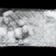

# AiRT

AiRT turns a single word into a generated image. I built it in 2022 as my final project for the Machine Learning, Deep Learning and Artificial Intelligence course at ITS Angelo Rizzoli in Milan.

## Built before the AI boom

I wrote this code between May and July 2022, a few months before generative AI went mainstream. OpenAI had announced DALL·E 2 in April and kept it behind a waitlist. Stable Diffusion came out in August 2022, ChatGPT in November.

AiRT uses what a student project could train and run in 2022: one small GAN per word, trained on images scraped from the web. For the training data I picked [freeimages.com](https://www.freeimages.com/), a site of free stock photos, so the dataset would stay clear of copyright issues. Each generator produces a 28×28 grayscale image, and a pretrained super-resolution model scales it up to 112×112. The results look rough next to today's models; they show what a small GAN could learn from a few pages of web search results.

I keep this repository as it was in 2022. It is an archive: I don't maintain it, and some parts don't work (see [Known issues](#known-issues)).

## Sample output

<p>
  
  
  
  
  
</p>

Images generated for "mountain", "sea" and "dog", at 112×112.

## How it works

```
React + MUI  ──HTTP──▶  FastAPI  ──▶  PostgreSQL (users, models, images, requests)
                           │
                           ├─ a generator exists for the word
                           │     Keras generator (28×28 grayscale)
                           │       → ESRGAN 4× upscaling (TensorFlow Hub)
                           │       → 112×112 PNG in images/, served at /images
                           │
                           └─ no generator yet
                                 scraper: freeimages.com search results
                                   (requests + BeautifulSoup for the pages, aiohttp for downloads)
                                   → grayscale, padded to square, resized to 28×28
                                 → DCGAN training (TensorFlow/Keras) → generator saved to models/
```

- **Generating.** When you ask for a word that already has a generator, the backend picks one, feeds it a random 100-value noise vector and upscales the result with [ESRGAN](https://tfhub.dev/captain-pool/esrgan-tf2/1). It records each request in PostgreSQL, linked to the image it produced.
- **Training.** `utils/GAN.py` holds a DCGAN based on the TensorFlow tutorial: a generator built from transposed convolutions and a convolutional discriminator, both trained with Adam and binary cross-entropy. During training it saves a 4×4 grid of samples per epoch, so you can watch the generator improve; the frontend shows that progress as GIFs.
- **Demo models.** I trained generators for cat, dog, mountain, face and sea. The `.h5` files are not in the repository.

The frontend's "About" pages contain the original project write-up in Italian: the idea, the competition, the dataset and the GAN.

## Tech stack

| Area | Tools |
|---|---|
| Backend | Python 3.9, FastAPI, Pydantic, SQLAlchemy, PostgreSQL |
| ML | TensorFlow 2.8 / Keras, TensorFlow Hub (ESRGAN), NumPy |
| Data collection | requests, BeautifulSoup, aiohttp, Pillow |
| Frontend | React 18, Material UI, React Router |

## Repository layout

The complete project is on the `dev` branch. `main` holds an early skeleton from June 2022.

```
main.py                  FastAPI app: login, registration, generation endpoint, static images
constants.py             paths, image size, training parameters
db_management/           SQLAlchemy engine and models (User, Model, Image, Request)
API_utils/               generation and training request handling, Pydantic schemas
utils/image_scraper.py   dataset scraper
utils/GAN.py             DCGAN definition and training loop
utils/image_generator.py sampling and ESRGAN upscaling
templates/gan_frontend/  React frontend
images/                  images generated during development
```

## Known issues

I left these as they were in 2022.

- Login is a placeholder: the app stores passwords in plain text and uses the username as the bearer token.
- `db_management/database.py` hard-codes the local PostgreSQL credentials.
- The sign-in page logs the username and password to the browser console.
- On-demand training never starts: `main.py` passes the script path and the word to `subprocess.Popen` as one string.
- The command-line entry point of `utils/GAN.py` calls `checkpoint.train(...)` instead of `train(...)`, a regression from June 2022, so it saves an untrained model.
- The frontend promises an email when a new model is ready, and the database has subscription tiers. I never implemented either.
